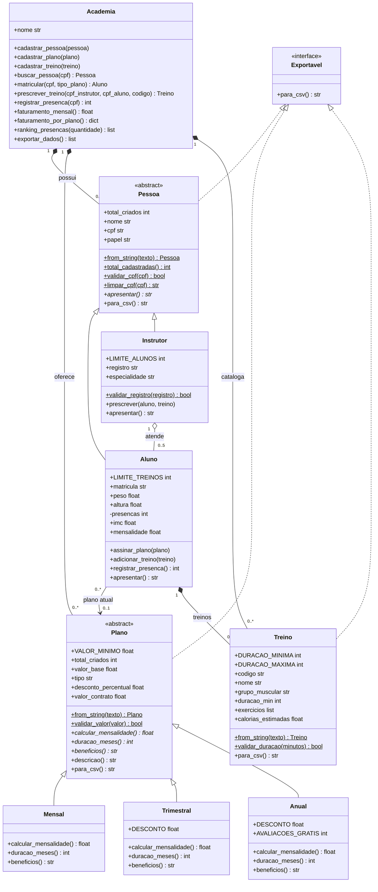

# Diagrama de classes – Academia

Legenda: `<|--` herança · `*--` composição · `o--` agregação · `-->` associação · `<|..` implementa o Protocol · `$` método estático/de classe · `*` método abstrato · `-` privado.
